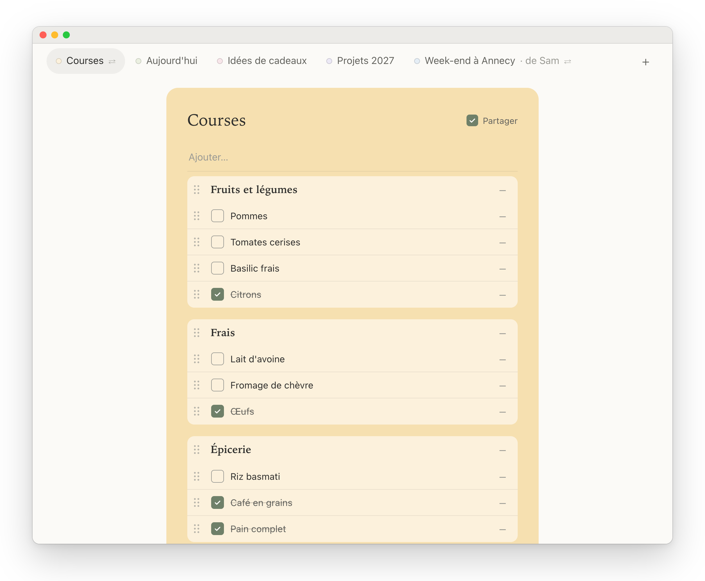
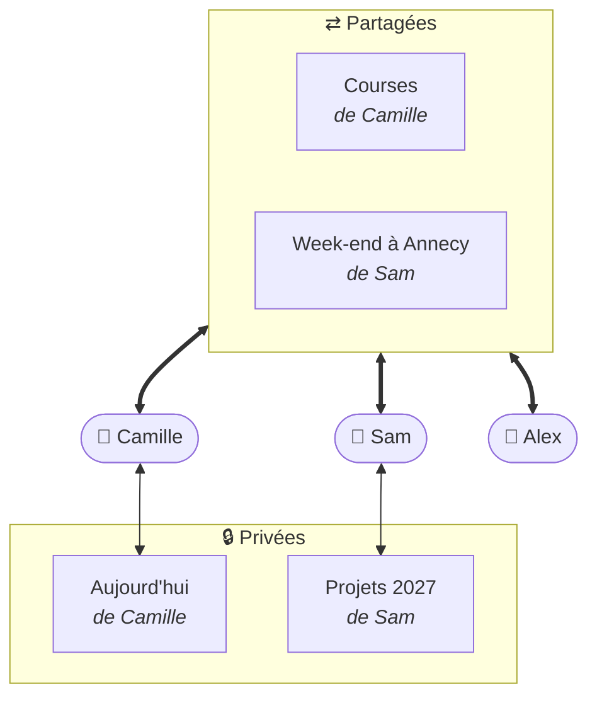
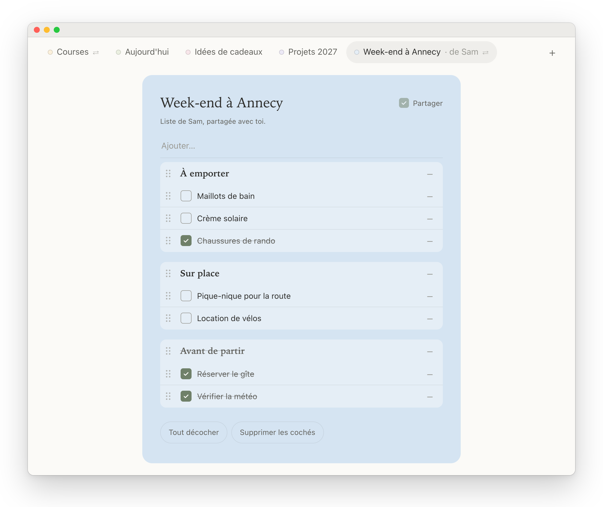
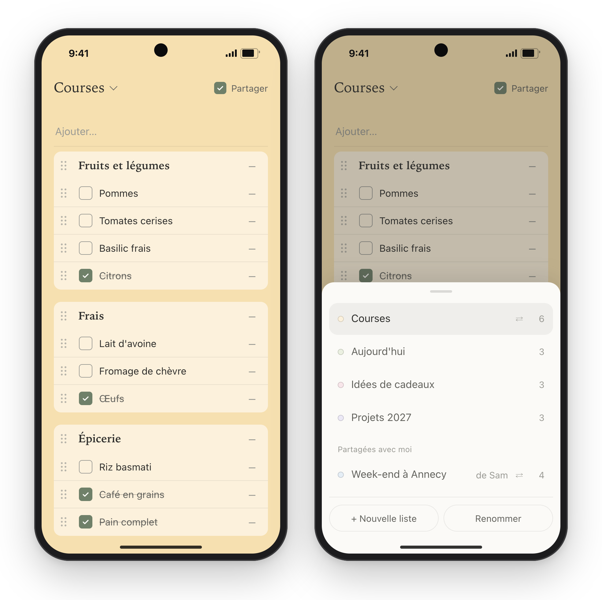

# giga-simple-lists

Des listes à cocher, partagées en temps réel, à auto-héberger. Courses, choses à faire aujourd'hui,
projets de l'année : chaque liste n'est qu'une suite de cases à cocher, toujours modifiable.

[English version](README.md)



- Plusieurs listes, plusieurs comptes. Une liste est privée par défaut ; « Partager » la rend
  visible par tous les comptes de l'instance, ou seulement par les comptes choisis (les parents,
  pas les enfants). Ils peuvent alors la renommer et en modifier les éléments ; la couleur, le
  partage et la suppression restent réservés à son propriétaire.
- Lien public pour cocher seulement : un lien à envoyer à quelqu'un sans compte (l'ami qui fait les
  courses). Il voit la liste et coche au fur et à mesure, en temps réel et même hors ligne, et ne
  peut rien faire d'autre : ni ajouter, ni modifier, ni supprimer. Le lien se remplace ou se coupe à
  tout moment.
- Éléments réordonnables par glisser-déposer ; « Supprimer les cochés » supprime d'un coup les
  éléments cochés, « Tout décocher » les remet à faire (courses récurrentes). Quand rien n'est
  coché, le même bouton devient « Tout cocher ».
- Comptes gérés dans l'appli : liens d'invitation, page d'administration, et page « Mon compte »
  pour changer de mot de passe et déconnecter ses appareils. Plus besoin de la ligne de commande.
- Catégories : « # Fruits » dans le champ d'ajout crée un titre qui regroupe les éléments placés
  sous lui (un seul niveau). Elle ne se coche pas, mais se raye quand tous ses éléments sont
  cochés, et se déplace avec eux. Coller plusieurs lignes ajoute un élément par ligne.
- Annuler une suppression (élément, catégorie, cochés ou liste entière) : un bandeau « Annuler »
  apparaît en bas, et Ctrl+Z / ⌘Z fonctionne aussi. Les 5 dernières suppressions sont gardées.
- Temps réel : une case cochée sur un téléphone apparaît sur l'autre en moins d'une seconde.
- Hors ligne : l'appli s'ouvre sans réseau sur les dernières listes vues, et les actions faites
  sans réseau sont renvoyées au retour de la connexion.
- **Dupliquer une liste** pour s'en servir de modèle (« Valise ») : une copie privée, tout décoché.
- **Tes données restent à toi** : exporte tes listes en JSON depuis « Mon compte », réimporte-les
  (ou dans une autre instance).
- **Intégrations**, toutes optionnelles : un jeton d'API personnel pour ajouter des éléments depuis
  Home Assistant ou un raccourci du téléphone, et la connexion par un proxy d'authentification
  (Authelia, Authentik).
- Sur téléphone, le titre de la liste ouvre un panneau, en bas de l'écran, avec toutes les listes
  et le nombre d'éléments à faire de chacune ; on le replie en tirant sa poignée vers le bas.
- Appli web installable sur l'écran d'accueil (iOS, Android), modes clair et sombre selon le
  réglage de l'appareil.
- Interface en français ou en anglais, choisie une fois pour toute l'instance (`LISTES_LANG=fr`).
- Un binaire Go statique et une base SQLite : moins de 30 Mo de RAM, image d'environ 16 Mo, pour
  amd64, arm64 et arm/v7 (Raspberry Pi 2 et suivants).

Qui voit quoi : chaque compte a ses listes privées, que lui seul voit. Une liste partagée avec tout
le monde apparaît chez tous les comptes de l'instance ; une liste partagée avec des comptes précis,
seulement chez eux. Ils peuvent la renommer et en modifier les éléments ; sa couleur, son partage et
sa suppression restent à son propriétaire. Un lien public ne permet que de cocher.





<p align="center">
  
</p>

Captures faites sur des données inventées.

## Hors périmètre

L'appli ne fait qu'une chose. Ne sont volontairement **pas** prévus (une pull request qui les
ajoute sera refusée) :

- dates d'échéance, rappels, notifications, tâches récurrentes ;
- priorités, étiquettes, notes, pièces jointes, sous-tâches au-delà d'un niveau de catégorie ;
- une page de réglages : les quelques options (langue, origine…) sont dans l'environnement ;
- une appli mobile native : l'appli web installable suffit ;
- toute connexion sortante (ni télémétrie, ni vérification de mise à jour, ni police ou CDN externe).

## Déploiement

La CI publie l'image `ghcr.io/fileboss/giga-simple-lists` pour amd64, arm64 et arm/v7 : chaque tag
`vX.Y.Z` donne `:vX.Y.Z`, `:X.Y.Z`, `:X.Y` et `:X`, les versions à épingler ; `main` donne
`:latest` et `:sha-…`, pour le dev seulement. Le `compose.yaml` du dépôt ne sert qu'au dev local ;
un exemple de déploiement durci est dans le [README anglais](README.md#quick-start) (ajouter
`LISTES_LANG: fr`).

Contrat du conteneur : uid 1000, base `/data/listes.db` (un seul fichier SQLite, à sauvegarder avec
`sqlite3 .backup`), port 5240, `GET /healthz` (healthcheck intégré à l'image), `LISTES_ORIGIN`
obligatoire. Il faut un reverse proxy qui sert l'appli en HTTPS : les cookies de session sont
`Secure`. Les migrations de la base sont intégrées au binaire et s'appliquent au démarrage.

### Essayer sur le réseau local, sans HTTPS

En `http://192.168.x.x:5240`, les navigateurs refusent les cookies `Secure` et la connexion échoue
sans explication. `http://localhost` marche tel quel. Pour toute autre adresse en HTTP, l'appli
refuse de démarrer et dit pourquoi, sauf choix explicite :

```yaml
      LISTES_ORIGIN: http://192.168.1.10:5240
      LISTES_INSECURE_HTTP: "true"
```

Les cookies perdent alors l'attribut `Secure` et le préfixe `__Host-` : n'importe qui sur le réseau
peut les lire. À réserver à un réseau local de confiance. En HTTP, le navigateur désactive aussi le
service worker : l'appli ne s'ouvre pas hors ligne et ne s'installe pas (les actions faites sans
réseau restent mises en file tant que la page est ouverte). L'option est refusée avec une origine
`https://`.

## Comptes

Pas d'inscription libre : on rejoint l'instance par un lien d'invitation. Tout se fait dans l'appli :

- **Premier compte** : au premier démarrage, les journaux donnent un lien à usage unique
  (`docker compose logs listes | grep invite`) pour créer le premier compte, admin. Il est renouvelé
  à chaque démarrage tant qu'aucun compte n'existe, et expire au bout de 24 h.
- **Mon compte** (ton nom, en bas de l'appli) : changer de mot de passe, voir les appareils connectés
  et les déconnecter. Changer de mot de passe déconnecte tous les autres appareils.
- **Administration** (admins seulement) : créer un lien d'invitation à usage unique, valable 7 jours,
  éventuellement pour un admin ; la personne choisit son nom et son mot de passe. Pour chaque compte :
  un lien de nouveau mot de passe (valable 24 h, l'admin ne voit jamais le mot de passe), rendre ou
  retirer admin, déconnecter partout, supprimer le compte et ses listes. L'instance garde toujours au
  moins un admin.

Les liens ne sont affichés qu'une fois et ne servent qu'une fois ; seul leur hash est gardé. Sur une
instance créée avant la gestion des comptes dans l'appli, le plus ancien compte devient admin.

La ligne de commande reste disponible, pour des scripts ou pour reprendre la main :

```sh
docker compose exec listes listes user invite [--admin]   # affiche un lien d'invitation à usage unique
docker compose exec listes listes user add <nom>          # affiche un mot de passe généré, une seule fois (le premier compte est admin)
docker compose exec -T listes listes user add <nom> --password-stdin <<<'mot de passe choisi (15 caractères min.)'
docker compose exec listes listes user reset <nom>        # nouveau mot de passe, sessions révoquées
docker compose exec listes listes user admin <nom> [--revoke]
docker compose exec listes listes user list
docker compose exec listes listes sessions revoke-all     # déconnecte tous les appareils
```

## Sauvegarde

L'image n'a ni shell ni `sqlite3` : le binaire fait lui-même une copie cohérente, même pendant que
le serveur tourne.

```sh
docker compose exec listes listes backup                  # /data/listes-backup-<date>.db
docker compose exec listes listes backup /data/jour.db    # n'écrase jamais un fichier existant
```

La copie est une base SQLite complète : pour restaurer, arrêter le conteneur et remplacer
`listes.db` par elle. `sqlite3 listes.db ".backup copie.db"` depuis l'hôte marche aussi.

## Intégrations

### Ajouter des éléments depuis un autre outil (jeton d'API)

Dans « Mon compte », crée un jeton d'API personnel (affiché une seule fois, révocable). Puis :

```sh
curl -X POST https://listes.example.com/api/v1/items \
  -H 'Authorization: Bearer gsl_…' \
  -H 'Content-Type: application/json' \
  -d '{"list": "Courses", "text": "Lait"}'
```

- `list` : le nom de la liste (sans tenir compte de la casse ; tes listes d'abord si deux ont le même
  nom) ou son identifiant. Un nom porté par plusieurs listes d'autres comptes répond `409` : il
  faut alors l'identifiant. `text` : l'élément, ajouté à la fin comme avec le champ « Ajouter ».
  `"category": true` ajoute un titre de catégorie. Réponse `201` avec l'élément ; tous ceux qui
  regardent la liste le voient en direct.
- `nonce` (facultatif, 32 caractères hexadécimaux en minuscules) : une nouvelle tentative avec le même nonce
  n'ajoute pas l'élément deux fois.
- `GET /api/v1/lists` donne les noms et identifiants utilisables, avec le nombre d'éléments à faire.
- Au plus 60 appels par minute et par compte. Le jeton permet de voir le nom des listes que voit son
  compte et d'y ajouter des éléments : range-le dans un coffre à secrets. Changer le mot de passe le
  révoque.

Home Assistant (`configuration.yaml`), puis appelle `rest_command.ajouter_courses` depuis une
automatisation ou un assistant vocal :

```yaml
rest_command:
  ajouter_courses:
    url: https://listes.example.com/api/v1/items
    method: post
    headers:
      Authorization: !secret listes_token
    content_type: application/json
    payload: '{"list": "Courses", "text": {{ item | to_json }}}'
```

(`listes_token` dans `secrets.yaml` vaut `Bearer gsl_…`.)

### Connexion par un proxy d'authentification

Si Authelia, Authentik ou un autre proxy authentifie déjà les gens et transmet leur nom dans un
en-tête, règle `LISTES_AUTH_HEADER=Remote-User`. Une requête qui le porte connecte ce compte, sans
mot de passe. L'en-tête n'est cru **que** depuis `127.0.0.1` et `LISTES_TRUSTED_PROXIES`, et ne
désigne qu'un compte existant (les comptes se créent toujours par invitation). À n'utiliser que si
**tous** les chemins vers l'appli passent par ce proxy et qu'il pose (écrase) toujours l'en-tête ; la
déconnexion se fait alors au proxy. Pour que le jeton d'API marche, ne laisse passer sans
l'authentification du proxy que `/api/v1/` (pas tout `/api/`), et garde le proxy qui retire
l'en-tête là aussi. Voir [SECURITY.fr.md](SECURITY.fr.md).

### Export et import

« Mon compte » → « Mes données » : **Exporter mes listes** télécharge un fichier JSON avec les listes
dont tu es propriétaire et leurs éléments. **Importer** lit un tel fichier et crée toujours de
nouvelles listes privées (rien n'est fusionné ni écrasé) : de quoi aussi passer d'une instance à une
autre.

## Reverse proxy

L'appli doit être servie à l'adresse exacte de `LISTES_ORIGIN`. Le reverse proxy doit :

- **ne pas mettre en tampon** le flux temps réel (`/api/events`, Server-Sent Events) ;
- **remplacer** `X-Forwarded-For` par l'IP du client (l'appli en lit la dernière valeur, pour
  limiter les tentatives de connexion par IP) ;
- ajouter HSTS, `X-Content-Type-Options: nosniff` et `Referrer-Policy`. L'appli pose elle-même la
  CSP, COOP, CORP, `Permissions-Policy`, `X-Frame-Options` et `Cache-Control`.

Caddy (le certificat HTTPS est automatique, et Caddy remplace déjà `X-Forwarded-For`) :

```caddyfile
listes.example.com {
    header {
        Strict-Transport-Security "max-age=31536000; includeSubDomains"
        X-Content-Type-Options nosniff
        Referrer-Policy strict-origin-when-cross-origin
        -Server
    }
    reverse_proxy 127.0.0.1:5240 {
        flush_interval -1
    }
}
```

nginx :

```nginx
location / {
    proxy_pass http://127.0.0.1:5240;
    proxy_set_header Host $host;
    proxy_set_header X-Forwarded-For $remote_addr;
    proxy_buffering off;
    proxy_read_timeout 1h;
}
```

Si le reverse proxy tourne sur une autre machine (par un tunnel ou un VPN), il faut qu'il atteigne
le port `127.0.0.1:5240` de l'hôte de l'appli par un relais local, et que personne d'autre ne puisse
joindre ce relais : toute connexion qui arrive par là est crue sur son `X-Forwarded-For`.

## Configuration

| Variable | Défaut | Rôle |
|---|---|---|
| `LISTES_ORIGIN` | (obligatoire) | URL publique ; seule origine acceptée pour les requêtes qui modifient |
| `LISTES_LANG` | `en` | Langue de l'interface, des messages d'erreur, de la ligne de commande et des journaux : `en` ou `fr` |
| `LISTES_TRUSTED_PROXIES` | (aucune) | IP, séparées par des virgules, dont `X-Forwarded-For` est lu, en plus de `127.0.0.1` : la passerelle du réseau Docker par laquelle arrive le port publié |
| `LISTES_INSECURE_HTTP` | `false` | autorise une origine `http://` autre que localhost (réseau local de confiance, voir plus haut) |
| `LISTES_AUTH_HEADER` | (aucun) | en-tête posé par un proxy d'authentification avec le nom du compte (`Remote-User`) ; cru seulement depuis les relais ci-dessus (voir Intégrations) |
| `LISTES_DB` | `/data/listes.db` | chemin de la base |
| `LISTES_ADDR` | `:5240` | adresse d'écoute |
| `TZ` | (UTC) | fuseau horaire (horodatage des journaux) |
| `GOMEMLIMIT` | (aucune) | à régler sous la limite mémoire du conteneur (ex. `96MiB` pour 128 Mo) |

### Limites

| | |
|---|---|
| Listes par compte | 200 |
| Éléments par liste | 2 000 |
| Texte d'un élément / nom de liste | 500 / 80 caractères |
| Flux temps réel ouverts | 64 au total, 4 par session |
| Sessions | 90 jours sans visite, 180 jours au plus |
| Base de données | 50 Mo |

## Développer

Sans Go installé, tout passe par Docker :

```sh
cd app
docker run --rm -v "$PWD:/src" -w /src golang:1.27-alpine sh -c 'go vet ./... && go test ./...'
docker run --rm -v "$PWD:/src" -w /src golang:1.27-alpine go run golang.org/x/vuln/cmd/govulncheck@v1.9.0 ./...
```

Lancer en local (le navigateur accepte les cookies `Secure` sur `localhost`) :

```sh
mkdir -p data && chmod 777 data
docker compose up -d --build
docker compose exec listes listes user add alice
open http://localhost:5240
```

Chaque version est un tag (`v1.0.0`, `v1.0.1`…), publié comme image par la CI. Dependabot propose
chaque semaine les mises à jour des images de base, des dépendances Go et des actions GitHub ; la CI
lance `gofmt`, `go vet`, `go test -race`, `govulncheck` (aussi chaque nuit) et vérifie que l'image
de chaque plateforme fait moins de 20 Mo avant de la publier. Les traductions sont dans
[`app/i18n.go`](app/i18n.go) ; un test vérifie que chaque langue a toutes les clés.

## Points de conception

- **Accès** : une seule règle, `visibleTo` (propriétaire, liste partagée avec tout le monde, ou
  membre de la liste), et un seul passage
  obligé, `accessList` / `accessItem` (`store.go`), pour toutes les routes. Le flux SSE applique
  `visibleTo` à chaque destinataire, sur l'état de la liste après la modification.
  Le droit sur un élément vient de sa liste, retrouvée côté serveur. Liste privée d'un autre : 404.
- **Identifiants** : 128 bits. À la création, ils sont dérivés d'un nonce aléatoire du client
  (`sha256(utilisateur, nonce)`). Le client connaît l'identifiant tout de suite (mises à jour
  optimistes, file hors ligne), un renvoi est idempotent, et un autre utilisateur ne peut pas
  produire le même identifiant.
- **Temps réel** : SSE. Les écritures et la publication des événements partagent un même verrou,
  donc l'ordre des événements suit celui des commits et la visibilité est évaluée sur l'état exact.
  Une liste qui redevient privée n'envoie aux autres qu'un retrait (`{id, reason}`).
- **Hors ligne** : un service worker (`/sw.js`) sert la page et ses fichiers depuis le réseau
  d'abord, et depuis son cache seulement si le réseau ne répond pas (erreur, 502-504, ou rien
  sous 4 s) : jamais de version périmée en ligne. L'API et le flux SSE ne passent pas par lui.
  `app.js` garde une copie des listes (`localStorage`), affichée à l'ouverture puis remplacée par
  l'état du serveur. La déconnexion efface la page en cache et cette copie ; une redirection vers
  `/login` (session expirée) efface aussi la page.
  File d'opérations dans le navigateur (`localStorage`), renvoyée dans l'ordre.
  Chaque opération est idempotente ; « Supprimer les cochés » envoie les éléments vus cochés, pour ne
  pas supprimer au renvoi ce qu'un autre a coché entre-temps.
  Délai de 15 s par requête, ping SSE toutes les 20 s, surveillé côté client.
- **Sécurité** (choix et raisons : [SECURITY.fr.md](SECURITY.fr.md)) : connexion par mot de passe seul (Argon2id, paramètres OWASP), temps de réponse
  constant et message unique ; blocage par IP, simple ralentissement par compte (plafonné à 1 min,
  pour qu'un tiers ne puisse pas bloquer un compte), stockés en base ; cookie `__Host-session`
  (seul le hash est en base), Origin + Sec-Fetch-Site + jeton CSRF, CSP sans inline.
  `X-Forwarded-For` n'est lu que depuis 127.0.0.1 ou une adresse de `LISTES_TRUSTED_PROXIES`.
- **Isolation** (une faille dans l'appli ne doit mener nulle part) : distroless sans shell,
  non-root, base plafonnée à 50 Mo (507 « Stockage plein » au-delà, lecture intacte), journal
  applicatif limité à une ligne par minute pour un même message. Le déploiement doit ajouter
  `cap_drop: ALL`, `no-new-privileges`, `read_only`, un seul volume, `pids_limit`, `nofile`, des
  journaux bornés, un port publié sur `127.0.0.1`, et bloquer toute connexion sortante : l'appli
  n'en a besoin d'aucune.
