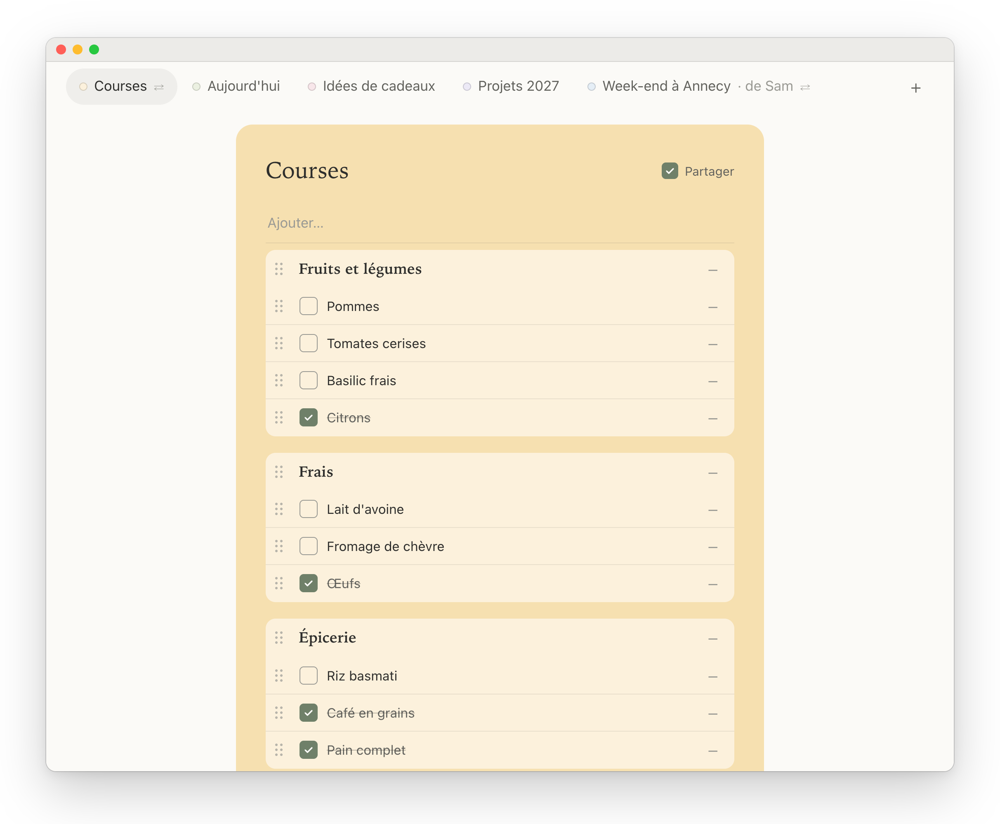
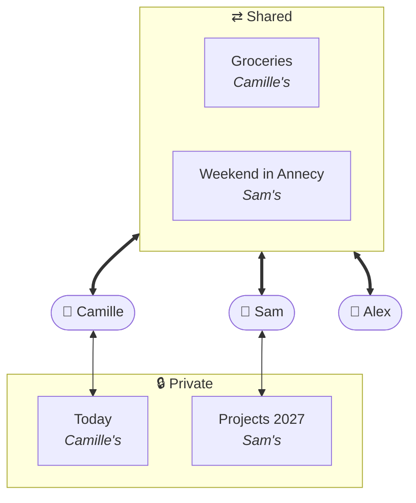
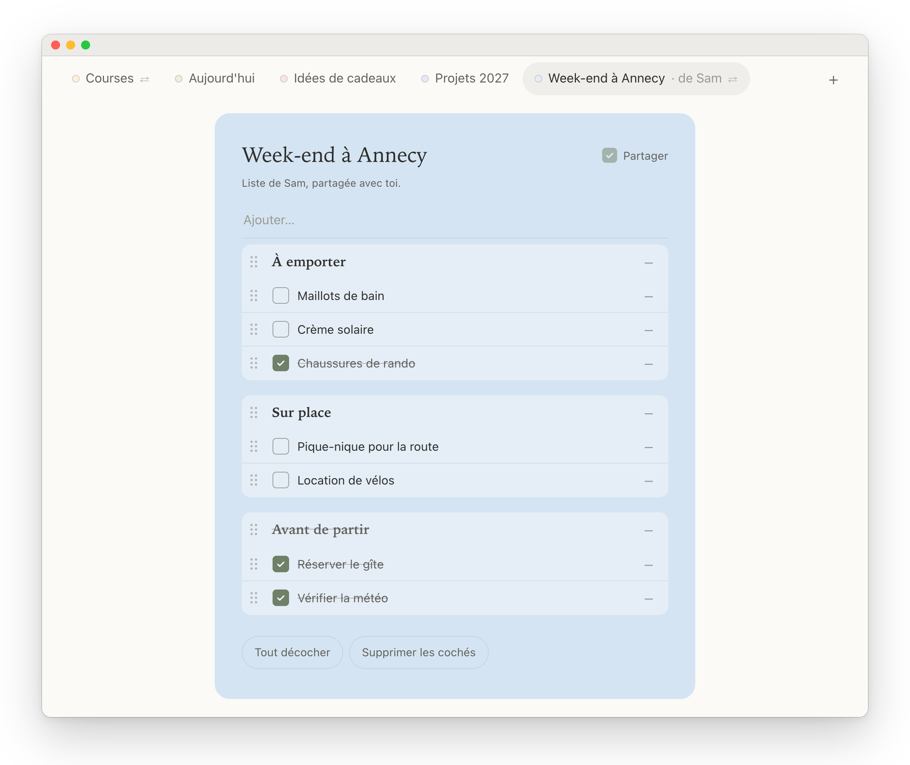
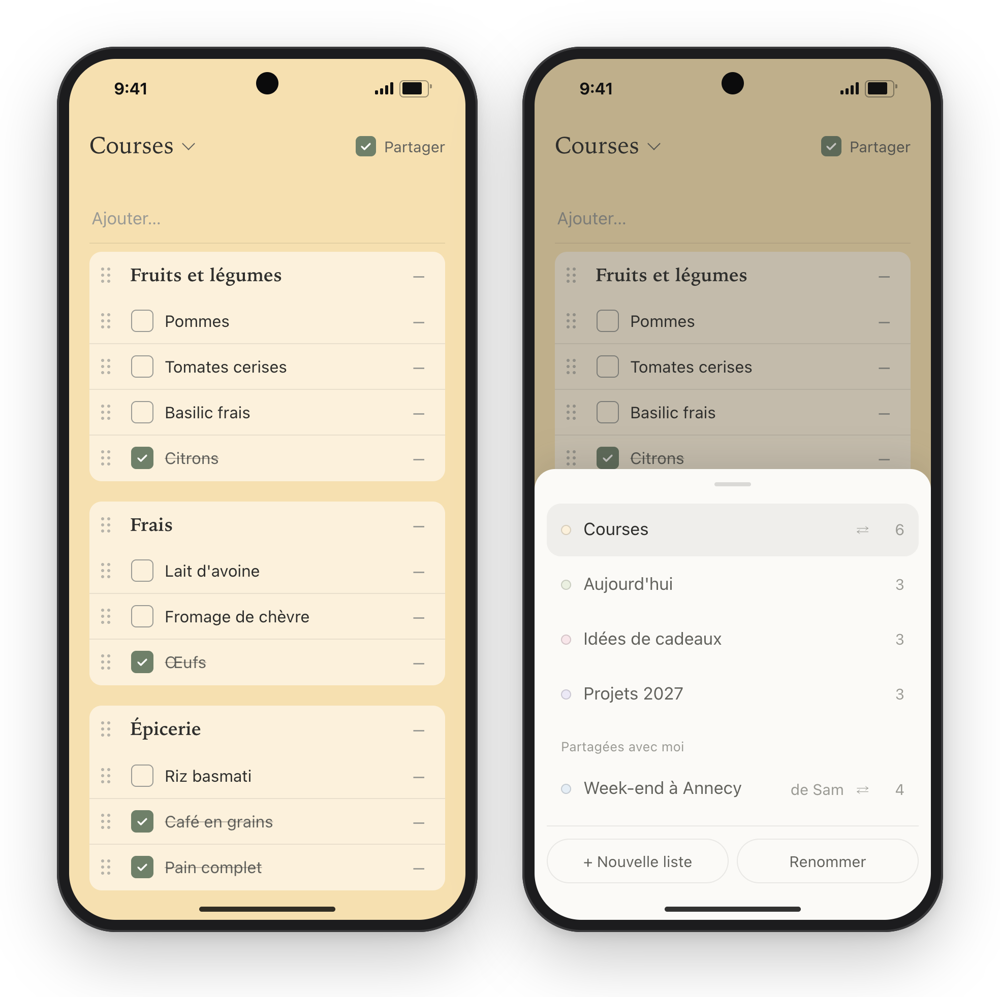

# giga-simple-lists

Self-hosted checklists, shared in real time. Groceries, today's to-dos, this year's projects: every
list is just a series of checkboxes, always editable. One static Go binary, one SQLite file, a
~16 MB image, under 30 MB of RAM.

[Version française](README.fr.md)



## What it does

- **Lists of checkboxes**, nothing else. Add with Enter, click to check, click the text to edit it.
  Checked items sink to the bottom, greyed out.
- **Real time**: check an item on one phone and it appears on the other in under a second (SSE).
- **Works offline**: the app opens without network on the last lists seen, and changes made offline
  are sent when the connection comes back. Built for the supermarket basement.
- **Several accounts, private or shared lists.** A list is private by default; the "Share" box makes
  it visible to every account on the instance, who can then rename it and edit its items. Colour,
  sharing and deletion stay with its owner.
- **Categories**: typing `# Fruit` creates a heading that groups the items below it (one level).
  It cannot be checked, is struck through once all its items are checked, and moves with them.
  Pasting several lines adds one item per line.
- Drag-and-drop reordering; "Delete checked" clears them in one go, "Uncheck all" resets a recurring
  list (groceries). When nothing is checked, the same button becomes "Check all".
- **Undo** a deletion (item, category, checked items or a whole list): an "Undo" banner appears at
  the bottom, and Ctrl+Z / ⌘Z works too. The last 5 deletions are kept.
- On a phone, the list title opens a bottom sheet with every list and its number of items left.
- Installable web app (iOS, Android), **light and dark mode** following the device setting.
- Interface in **English or French**, chosen once per instance (`LISTES_LANG`).
- Images for **amd64, arm64 and arm/v7** (Raspberry Pi 2 and later).

Who sees what: each account has its private lists, visible only to itself. A shared list appears for
every account on the instance, who can rename it and edit its items; its colour, sharing and
deletion stay with its owner.





<p align="center">
  
</p>

Screenshots show the French interface, with made-up data.

## Non-goals

The app does one thing. These are deliberately **not** planned, and pull requests adding them will
be declined:

- due dates, reminders, notifications, recurring tasks;
- priorities, tags, notes, attachments, sub-tasks deeper than one category level;
- a settings page: the few options (language, origin…) live in the environment;
- a native mobile app: the installable web app is the app;
- outgoing connections of any kind (no telemetry, no update check, no external fonts or CDN).

## Quick start

The image is `ghcr.io/fileboss/giga-simple-lists`. Each release `vX.Y.Z` is published as `:X.Y.Z`,
`:X.Y` and `:X`; pin one of them. `:latest` follows `main` and is for development only.

`compose.yaml`:

```yaml
services:
  listes:
    image: ghcr.io/fileboss/giga-simple-lists:2
    restart: unless-stopped
    user: "1000:1000"            # owner of ./data
    read_only: true
    cap_drop: [ALL]
    security_opt: [no-new-privileges:true]
    mem_limit: 128m
    pids_limit: 64
    ports:
      - "127.0.0.1:5240:5240"    # only the reverse proxy reaches it
    volumes:
      - ./data:/data
    networks: [listes]
    environment:
      LISTES_ORIGIN: https://lists.example.com   # exact public URL
      LISTES_LANG: en                            # or fr
      # The published port arrives from the network gateway: trust its X-Forwarded-For.
      LISTES_TRUSTED_PROXIES: 172.29.52.1
      GOMEMLIMIT: 96MiB
      TZ: Europe/Paris

networks:
  listes:
    ipam:
      config:
        - subnet: 172.29.52.0/24
          gateway: 172.29.52.1
```

```sh
mkdir -p data && sudo chown 1000:1000 data
docker compose up -d
docker compose exec listes listes user add alice   # prints a generated password, once
```

Then put it behind a reverse proxy that serves it over HTTPS (see [Reverse proxy](#reverse-proxy)).
Session cookies are `Secure`.

Container contract: uid 1000, database `/data/listes.db` (a single SQLite file), port 5240,
`GET /healthz` (healthcheck built into the image), `LISTES_ORIGIN` required. Database migrations are
built into the binary and run at startup.

### Trying it on a local network, without HTTPS

Over plain `http://192.168.x.x:5240`, browsers drop `Secure` cookies and sign-in silently fails.
`http://localhost` works out of the box. For any other HTTP address, the app refuses to start and
says why, unless you explicitly opt in:

```yaml
      LISTES_ORIGIN: http://192.168.1.10:5240
      LISTES_INSECURE_HTTP: "true"
```

Cookies then lose their `Secure` flag and `__Host-` prefix: anyone on the network can read them.
Keep this to a trusted LAN. Browsers also disable the service worker over HTTP, so the app does not
open offline and cannot be installed; offline changes are still queued while the page stays open.
The option is refused with an `https://` origin.

## Accounts

There is no sign-up page: accounts are managed from the command line.

```sh
docker compose exec listes listes user add <name>       # prints a generated password, once
docker compose exec -T listes listes user add <name> --password-stdin <<<'chosen password (15 characters min.)'
docker compose exec listes listes user reset <name>     # new password, sessions revoked
docker compose exec listes listes user list
docker compose exec listes listes sessions revoke-all   # signs out every device
```

## Backup

The image has no shell and no `sqlite3`; the binary makes a consistent copy itself, even while the
server is running:

```sh
docker compose exec listes listes backup                 # /data/listes-backup-<date>.db
docker compose exec listes listes backup /data/today.db  # never overwrites an existing file
```

The copy is a complete SQLite database: to restore, stop the container and replace `listes.db`
with it. `sqlite3 listes.db ".backup copy.db"` from the host works too.

## Reverse proxy

The app must be served at the exact address of `LISTES_ORIGIN`. The reverse proxy must:

- **not buffer** the real-time stream (`/api/events`, Server-Sent Events);
- **replace** `X-Forwarded-For` with the client IP (the app reads its last value, to rate-limit
  sign-in attempts per IP);
- add HSTS, `X-Content-Type-Options: nosniff` and `Referrer-Policy`. The app sets the CSP, COOP,
  CORP, `Permissions-Policy`, `X-Frame-Options` and `Cache-Control` itself.

Caddy (automatic HTTPS certificate, and Caddy already replaces `X-Forwarded-For`):

```caddyfile
lists.example.com {
    header {
        Strict-Transport-Security "max-age=31536000; includeSubDomains"
        X-Content-Type-Options nosniff
        Referrer-Policy strict-origin-when-cross-origin
        -Server
    }
    reverse_proxy 127.0.0.1:5240 {
        flush_interval -1
    }
}
```

nginx:

```nginx
location / {
    proxy_pass http://127.0.0.1:5240;
    proxy_set_header Host $host;
    proxy_set_header X-Forwarded-For $remote_addr;
    proxy_buffering off;
    proxy_read_timeout 1h;
}
```

If the reverse proxy runs on another machine (through a tunnel or a VPN), it must reach port
`127.0.0.1:5240` of the app host through a local relay, and nobody else must be able to reach that
relay: any connection arriving that way is trusted for its `X-Forwarded-For`.

## Configuration

| Variable | Default | Purpose |
|---|---|---|
| `LISTES_ORIGIN` | (required) | Public URL; the only origin accepted for requests that modify data |
| `LISTES_LANG` | `en` | Language of the interface, error messages, command line and logs: `en` or `fr` |
| `LISTES_TRUSTED_PROXIES` | (none) | Comma-separated IPs whose `X-Forwarded-For` is read, in addition to `127.0.0.1`: the Docker network gateway the published port arrives through |
| `LISTES_INSECURE_HTTP` | `false` | Allow an `http://` origin other than localhost (trusted LAN only, see above) |
| `LISTES_DB` | `/data/listes.db` | Database path |
| `LISTES_ADDR` | `:5240` | Listen address |
| `TZ` | (UTC) | Time zone (log timestamps) |
| `GOMEMLIMIT` | (none) | Set below the container memory limit (e.g. `96MiB` for 128 MB) |

### Limits

| | |
|---|---|
| Lists per account | 200 |
| Items per list | 2,000 |
| Item text / list name | 500 / 80 characters |
| Open real-time streams | 64 in total, 4 per session |
| Sessions | 90 days without a visit, 180 days at most |
| Database | 50 MB |

## Development

Without Go installed, everything goes through Docker:

```sh
cd app
docker run --rm -v "$PWD:/src" -w /src golang:1.27-alpine sh -c 'go vet ./... && go test ./...'
docker run --rm -v "$PWD:/src" -w /src golang:1.27-alpine go run golang.org/x/vuln/cmd/govulncheck@v1.9.0 ./...
```

Run locally (browsers accept `Secure` cookies on `localhost`):

```sh
mkdir -p data && chmod 777 data
docker compose up -d --build
docker compose exec listes listes user add alice
open http://localhost:5240
```

The repository's `compose.yaml` is for local development only. Every release is a tag (`v1.0.0`,
`v1.0.1`…), published as an image by CI. Dependabot proposes weekly updates of base images, Go
dependencies and GitHub Actions; CI runs `gofmt`, `go vet`, `go test -race`, `govulncheck` (also
nightly) and checks that each platform's image is under 20 MB before publishing it.

Code comments are in French. Translations live in [`app/i18n.go`](app/i18n.go); a test checks that
every language has every key.

## Design notes

- **Access**: a single rule, `visibleTo` (owner, or shared list), and a single gate,
  `accessList` / `accessItem` (`store.go`), for every route. The SSE stream applies `visibleTo` to
  each recipient, on the list's state after the change. Rights on an item come from its list, looked
  up server-side. Someone else's private list: 404.
- **Identifiers**: 128 bits. On creation, they are derived from a random client nonce
  (`sha256(user, nonce)`). The client knows the identifier immediately (optimistic updates, offline
  queue), a resend is idempotent, and another user cannot produce the same identifier.
- **Real time**: SSE. Writes and event publication share one lock, so event order follows commit
  order and visibility is evaluated on the exact state. A list that becomes private again only sends
  others a removal (`{id, reason}`).
- **Offline**: a service worker (`/sw.js`) serves the page and its files network-first, and from
  its cache only if the network does not answer (error, 502-504, or nothing within 4 s): never a
  stale version while online. The API and the SSE stream do not go through it. `app.js` keeps a copy
  of the lists (`localStorage`), shown at startup and then replaced by the server state. Signing out
  clears the cached page and that copy; a redirect to `/login` (expired session) clears the page too.
  Operations are queued in the browser (`localStorage`) and resent in order. Every operation is
  idempotent; "Delete checked" sends the items seen as checked, so a resend does not delete what
  someone else checked in the meantime. 15 s timeout per request, SSE ping every 20 s, watched by
  the client.
- **Security** (choices and reasons, in French: [SECURITY.md](SECURITY.md)): password-only sign-in
  (Argon2id, OWASP parameters), constant response time and a single message; per-IP blocking,
  per-account slowdown only (capped at 1 min, so a third party cannot lock an account out), stored
  in the database; `__Host-session` cookie (only its hash is stored), Origin + Sec-Fetch-Site + CSRF
  token, CSP without inline code. `X-Forwarded-For` is only read from 127.0.0.1 or an address in
  `LISTES_TRUSTED_PROXIES`.
- **Isolation** (a flaw in the app must lead nowhere): distroless without a shell, non-root,
  database capped at 50 MB (507 "Storage full" beyond, reads intact), application log limited to one
  line per minute for the same message. The deployment should add `cap_drop: ALL`,
  `no-new-privileges`, `read_only`, a single volume, `pids_limit`, `nofile`, bounded logs, a port
  published on `127.0.0.1`, and block every outgoing connection: the app needs none.

## License

MIT
